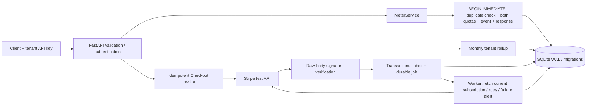

# Usage Metering & Billing Engine

[](https://github.com/tharxn/flyrank-capstone-metering-billing/actions/workflows/ci.yml)

Python track capstone: FastAPI, SQLite, exact integer billing math, two monthly
quotas, and Stripe **test-mode only** subscriptions. No AI service or payment
credentials are needed to run the metering demo or automated tests.

Validated on 2026-10-16: **74 automated tests passed**, and a hosted Checkout in
an actual temporary Stripe sandbox changed a tenant Free -> Pro through its
verified webhook. Forged-signature, real-event replay, and subscription-update
proofs are in [EVIDENCE.md](EVIDENCE.md). The temporary sandbox expires
2026-10-23; its credentials are not included in the repository.

## Run locally (Windows PowerShell)

Python 3.12+ is required. Clone the dedicated repository first:

```powershell
git clone https://github.com/tharxn/flyrank-capstone-metering-billing.git
Set-Location flyrank-capstone-metering-billing
```

Run these commands from this project directory:

```powershell
python -m venv .venv
.\.venv\Scripts\python.exe -m pip install -r requirements-dev.txt
if (-not (Test-Path .env)) { Copy-Item .env.example .env }
.\.venv\Scripts\python.exe -m app.cli seed
.\.venv\Scripts\python.exe -m app.cli run
```

Open [interactive API docs](http://localhost:8000/docs) or
[health](http://localhost:8000/health). On macOS/Linux, use
`.venv/bin/python` in place of `.\.venv\Scripts\python.exe`. All subsequent
`python` examples assume the project environment is activated, or that its full
interpreter path is used. The run command applies migrations and starts the
durable worker. Seed is repeatable and does not erase usage or rotate keys.

Seed creates `demo-alpha` and `demo-beta`, both on Free. Their independently
generated API keys are in ignored `data/demo-credentials.json`; only SHA-256
hashes are stored in the database. Treat the local credential file as a secret.
In `/docs`, supply `X-API-Key` in each authenticated endpoint's header field.

### Exercise metering

In a second PowerShell terminal:

```powershell
$demo = Get-Content data/demo-credentials.json -Raw | ConvertFrom-Json
$headers = @{
  'X-API-Key' = $demo.'demo-alpha'.api_key
  'Idempotency-Key' = 'first-generation'
}
$body = '{"input_tokens":1000,"cached_input_tokens":400,"output_tokens":500,"reasoning_tokens":200}'
Invoke-RestMethod http://localhost:8000/generate -Method Post -Headers $headers -ContentType application/json -Body $body
Invoke-RestMethod http://localhost:8000/generate -Method Post -Headers $headers -ContentType application/json -Body $body
Invoke-RestMethod http://localhost:8000/usage -Headers $headers
```

Both POST bodies are identical, with one event and $0.006600 modeled cost. A
retry carries `Idempotency-Replayed: true`. Reusing a successful key with other
token counts returns 409. Reuse across different tenants is independent.

The smoke script sends one small action twice and verifies the usage delta:

```powershell
.\.venv\Scripts\python.exe scripts/smoke.py
```

## Plans, boundaries, and pricing

| Plan | API calls / UTC calendar month | AI tokens / UTC calendar month |
| --- | ---: | ---: |
| Free | 1,000 | 100,000 |
| Pro | 10,000 | 1,000,000 |

An action uses **one API call plus input + output tokens**. Zero-token actions
are allowed and still use one call. Usage exactly at either limit is allowed;
the request that would exceed either limit gets **429** with `meter`, `used`,
`requested`, `limit`, `resets_at`, and `Retry-After` seconds. Nothing is recorded
when a request is rejected. A tenant at its token limit can still make a
zero-token action while calls remain. Successful retries are returned before
quota/payment checks, including after rollover.

Stripe `active`/`trialing` subscriptions on the configured Pro price grant Pro.
`past_due`, `unpaid`, `incomplete`, `incomplete_expired`, and `paused` return
**402** for new actions. `canceled` returns to Free immediately. A subscription
scheduled for cancellation keeps its active entitlement until Stripe reports
cancellation. An upgrade/downgrade keeps existing monthly usage; it never resets
the meters. A downgrade can leave usage above Free until the next month.
Verified cancellation releases the previous Checkout reservation so a new
subscription can be started immediately. Old successful keys still replay their
original response; repeated cancellation notifications cannot unlock a new
pending Checkout.

Prices are **simulated capstone constants**, pinned in `app/config.py` as
`simulated-usd-v1`. They are not a claim about current AI provider prices.

| Component | Integer micro-USD per unit | Equivalent |
| --- | ---: | --- |
| API call | 1,000 | $0.001/call |
| Uncached input token | 2 | $2/million tokens |
| Cached input token | 1 | $1/million tokens |
| Output token (includes reasoning) | 8 | $8/million tokens |

**Input includes cached tokens. Output includes reasoning tokens.** Validation
requires `cached_input_tokens <= input_tokens` and
`reasoning_tokens <= output_tokens`. Counts are nonnegative integers; floats,
booleans, numeric strings, and unknown fields are rejected with 422.

```text
total_tokens = input_tokens + output_tokens
token_cost = (input_tokens - cached_input_tokens) * 2
           + cached_input_tokens * 1
           + output_tokens * 8
action_cost = 1000 + token_cost                     (all integer micro-USD)
example     = 1000 + 600*2 + 400*1 + 500*8 = 6600 = $0.006600
```

Reasoning is already included in output, so adding it again would overcharge.
Costs and pricing versions are persisted per event. `/usage` sums stored costs,
so changing future prices cannot reprice history. USD displays are exact strings,
not JSON floats. Modeled usage is informational; Stripe only collects its separate
fixed recurring subscription amount (for example, $20/month).

## Architecture and persistence



- **HTTP:** `main.py`, `schemas.py`. Tenant identity comes from authentication;
  callers cannot choose a different tenant in a body or URL.
- **Logic:** `metering.py`, `billing.py`, `worker.py`. The simulated action and its
  event are one transaction; concurrent duplicate requests cannot double-count.
- **Data:** `db.py`, `migrations/001_initial.sql`. Foreign keys, CHECK constraints,
  UNIQUE tenant/idempotency key, unique Stripe identities, tenant/month indexes,
  and a versioned migration ledger. SQLite serializes writers across processes.
- **Provider boundary:** `stripe_gateway.py`. Stripe's official Python SDK,
  test-key guard, bounded HTTP timeout, sanitized provider errors.

See [DESIGN.md](DESIGN.md) for the design and failure model.

## API surface

| Method / endpoint | Credentials | Behavior |
| --- | --- | --- |
| `GET /health` | None | Database readiness |
| `POST /generate` | API key + idempotency key | Simulated action, atomic metering, per-call cost |
| `GET /usage` | API key | Current month's usage, limits, remaining, exact cost |
| `POST /billing/checkout` | API key + idempotency key | Test subscription Checkout URL |
| `GET /billing/subscription` | API key | Mirrored subscription state |
| `GET /billing/jobs` | API key | Latest 50 own jobs and failure alerts |
| `POST /webhooks/stripe` | Stripe signature | Verify, deduplicate, durably queue |
| `GET /billing/return` | None | Return message; never grants an entitlement |

All new billable calls use `Idempotency-Key`: 1..128 visible ASCII characters,
without spaces. It is tenant scoped, retained with the event, and not recycled
monthly. The API returns 401 for invalid tenant keys, 409 for conflicting retries,
422 for invalid input, and 503 for unconfigured Stripe or database unavailability.

## Connect Stripe test mode

The backend accepts test secret keys beginning with `sk_test_`, `rk_test_`, or
`rkcs_test_` (temporary CLI sandboxes). Restricted keys need permission for the
customer, Checkout, and subscription operations used by this app. Key validation
does not replace the provider checks: Stripe responses and webhook events with
`livemode: true` are still rejected.

### Existing Stripe account

1. In your Stripe **test** account, create a recurring monthly USD Price for Pro.
   A fixed $20/month test price is a suggested demo amount. Do not activate live
   mode, enter a real card, or add secrets to tracked files.
2. Put your test secret and recurring `price_...` ID in `.env` as
   `STRIPE_SECRET_KEY` and `STRIPE_PRO_PRICE_ID`.
3. Install the [Stripe CLI](https://docs.stripe.com/stripe-cli), authenticate with
   `stripe login`, and run this in its own terminal:

   ```text
   stripe listen --events checkout.session.completed,customer.subscription.updated,customer.subscription.deleted --forward-to localhost:8000/webhooks/stripe
   ```

4. Copy the CLI's `whsec_...` into `.env` as `STRIPE_WEBHOOK_SECRET`. Restart the
   API after changing environment variables. CLI and dashboard signing secrets
   differ; use the secret for the delivery path you are actually testing.

### Temporary sandbox without an account

Stripe also supports [anonymous CLI sandboxes](https://docs.stripe.com/cli/sandbox)
with working test API keys. They expire after **seven days**; use the expiration
returned by your own provisioning command. Claiming a sandbox requires Stripe
account registration and may be subject to regional onboarding availability.
Claiming is unnecessary for this temporary test.

The project-local Stripe CLI is installed at `.tools/node_modules/.bin/stripe.cmd`.
The entire `.tools/` directory is ignored by Git, including the isolated CLI
configuration and temporary credentials. On a fresh checkout with Node.js and npm
available, use the [official CLI installation](https://docs.stripe.com/cli/install)
package. In PowerShell, from this project directory:

```powershell
npm.cmd install --prefix .tools --no-save --package-lock=false @stripe/cli
$stripeExe = Join-Path $PWD '.tools\node_modules\.bin\stripe.cmd'
$stripeConfig = Join-Path $PWD '.tools\stripe\config.toml'
$stripeArgs = @('--config', $stripeConfig, '--project-name', 'capstone-temporary')
& $stripeExe @stripeArgs sandbox create --email 'you@example.com' --non-interactive
```

Replace `you@example.com` with **your own email address**. The dedicated config
file and `capstone-temporary` profile keep this workflow separate from your normal
Stripe CLI login. Reuse this sandbox for subsequent tests. If the profile already
contains an authenticated standard account, Stripe opens Dashboard management
instead of creating an anonymous sandbox.

The command displays a temporary `rkcs_test_...` secret, a publishable key, and a
claim URL. Keep that output private. Put the test secret in `.env` as
`STRIPE_SECRET_KEY`; this backend does not need the publishable key. Create the
test product and recurring price using the **same** isolated profile:

```powershell
& $stripeExe @stripeArgs products create --name 'Capstone Pro'
& $stripeExe @stripeArgs prices create --currency usd --unit-amount 2000 --product 'prod_REPLACE_WITH_YOUR_PRODUCT_ID' -d 'recurring[interval]=month'
```

Use the product ID returned by the first command in the second command. Put the
returned `price_...` ID in `.env` as `STRIPE_PRO_PRICE_ID`. In a separate terminal,
define the same `$stripeExe`, `$stripeConfig`, and `$stripeArgs` variables, then
start forwarding and leave it running:

```powershell
& $stripeExe @stripeArgs listen --events checkout.session.completed,customer.subscription.updated,customer.subscription.deleted --forward-to localhost:8000/webhooks/stripe
```

Put that listener's `whsec_...` in `.env` as `STRIPE_WEBHOOK_SECRET`, then restart
the API. If anonymous provisioning fails and the CLI falls back to browser signup,
the temporary sandbox has not been provisioned; resolve that step before trying
Checkout. Never commit `.env`, the CLI config, claim URL, or credential output.

### Complete and verify Checkout

These steps apply to either setup above. Configuration or session creation alone
does not establish that the acceptance test passed.

1. Create a Checkout through **this app** using the demo tenant's headers:

   ```powershell
   $demo = Get-Content data/demo-credentials.json -Raw | ConvertFrom-Json
   $checkoutHeaders = @{
     'X-API-Key' = $demo.'demo-alpha'.api_key
     'Idempotency-Key' = 'pro-checkout-1'
   }
   $checkout = Invoke-RestMethod http://localhost:8000/billing/checkout -Method Post -Headers $checkoutHeaders
   $checkout.url
   ```

2. Open that URL and use Stripe's test card `4242 4242 4242 4242`, any future
   expiry, and a test CVC. The backend sets tenant metadata on both Checkout and
   subscription; generic `stripe trigger` fixtures do not contain this mapping
   and therefore cannot prove the actual tenant upgrade.
3. After a valid webhook is durably queued (202), the worker fetches the current
   subscription and applies its real status. Poll `/billing/subscription` and
   `/billing/jobs` until processed, then `/usage` shows Pro limits. A Checkout
   redirect or session creation alone never changes the plan.
4. Cancel/update the subscription in Stripe test mode and check the corresponding
   verified notifications. Save a real event using `stripe events retrieve evt_...`
   and use the local replay helper below, or use Stripe's dashboard to resend to
   a registered endpoint. Generic `stripe trigger` fixtures can exercise delivery
   but do not carry this app's tenant mapping.

For an exact local replay of an existing real event through the listener, save
`stripe events retrieve evt_... > data/replay-event.json`, then run:

```powershell
.\.venv\Scripts\python.exe -m scripts.replay_webhook data/replay-event.json
.\.venv\Scripts\python.exe -m scripts.replay_webhook data/replay-event.json
```

For the temporary sandbox, retrieve the event with its isolated profile instead:

```powershell
& $stripeExe @stripeArgs events retrieve 'evt_REPLACE_WITH_YOUR_EVENT_ID' > data/replay-event.json
```

Then run the same replay helper twice as above.

This helper signs the saved JSON with the locally configured listener secret,
normalizing a shell's UTF-8/UTF-16 byte-order marker when needed.
It is a local acceptance tool, not evidence that Stripe delivered another event.
The second result is `duplicate`; no second job or entitlement change occurs.
Never edit the event ID to test a duplicate. See Stripe's
[webhook guidance](https://docs.stripe.com/webhooks) for raw-body verification,
duplicates, and unordered deliveries, and the
[Checkout API](https://docs.stripe.com/api/checkout/sessions/create) for session
parameters.

### Worker retries and alerts

The built-in worker polls durable jobs every second. It leases work for 60 seconds,
serializes sync per tenant, and retries failed attempts after 2 and 4 seconds
(three total attempts). Jobs survive restarts; expired leases can be reclaimed.
Fencing prevents a stale worker from overwriting a replacement's work.

Notifications only trigger a fresh Stripe read. They never apply the old snapshot
or sort by second-resolution event timestamps. This avoids late active snapshots
undoing a cancellation. Another tenant's metadata or an unexpected active Price
cannot grant Pro. Stripe customer/subscription IDs are unique across tenants.

After retries are exhausted, `jobs.status=dead`, a durable `alerts` row, a
sanitized `billing_sync_failed` log, and `/billing/jobs` expose the failure.
After fixing local credentials/configuration, an operator can explicitly requeue:

```text
python -m app.cli retry-job --job-id <failed-job-id>
```

For a separate worker, set `WORKER_ENABLED=false` in the API environment and run
`python -m app.cli worker`. `worker --once` processes at most one ready job.
Alerts are local log/database alerts; no outbound notification service is used.

## Test, lint, and submission files

```text
python -m app.cli test
python -m ruff check .
python -m ruff format --check .
```

Tests use independent temporary SQLite databases. They make no real Stripe or AI
calls. Signatures use the actual Stripe SDK with freshly generated synthetic
secrets. Adapter tests exercise the real Stripe SDK with intercepted HTTP.
GitHub Actions is supplied for Python 3.12 and 3.14; local validation used 3.14.

- [capstone.yaml](capstone.yaml): run/seed/test commands and evaluator probes.
- [EVIDENCE.md](EVIDENCE.md): captured checks mapped to the requirements,
  including actual Stripe sandbox Checkout, webhook, and replay evidence.
- [BUILDLOG.md](BUILDLOG.md): honest record of AI assistance and corrections.
- [.env.example](.env.example): every supported environment variable.
- [SUBMISSION_CHECKLIST.md](SUBMISSION_CHECKLIST.md): final PDF requirement audit,
  verification links, historical exceptions, and owner submission steps.

This project has its own public repository:
[tharxn/flyrank-capstone-metering-billing](https://github.com/tharxn/flyrank-capstone-metering-billing).
The repository was published on 2026-10-16, its first recorded build day.
Implementation began locally earlier that day. The design, implementation, and
submission pack were committed during publication; the original commit-as-you-build
sequence was not preserved. That history exception is recorded candidly in the
build log; no earlier chronology is manufactured. Portal
submission and the owner's code-understanding check remain owner actions.

## Optional Docker path

With Docker Desktop's engine running and modern Docker Compose:

```text
docker compose build
docker compose run --rm api python -m app.cli seed
docker compose up
```

The database and local seed credential file live in the `billing-data` named
volume. To use the credentials, inspect the file inside the container locally
(`docker compose exec api cat /app/data/demo-credentials.json`); do not paste its
contents into public evidence. Run the smoke script on the host using your own
private copy via `--credentials`. A fresh Linux image, isolated empty volume,
seed/run commands, non-root process, and retry-safe HTTP metering were verified
without host credentials; see [clean-start evidence](evidence/clean-start.json).

## Limitations

This is an intentionally bounded backend demo: SQLite on one machine, simulated
generation, local API-key provisioning via seed, no frontend, invoices, proration,
overages, or real usage charges. It is not a production billing provider. Database
write throughput is serialized; it does not claim a production multi-region
exactly-once guarantee. A real external AI action would need reservation/outbox
and provider-side idempotency beyond the atomic simulated action implemented here.
No automatic reconciliation scan is included, so a missed Stripe event needs
replay. Actual hosted test Checkout, clean Docker startup, and GitHub Actions on
Python 3.12/3.14 were verified; see the submission checklist for evidence links. Only the documented
snapshot webhook types are supported; thin events
are outside scope. No live keys or live events are accepted.
